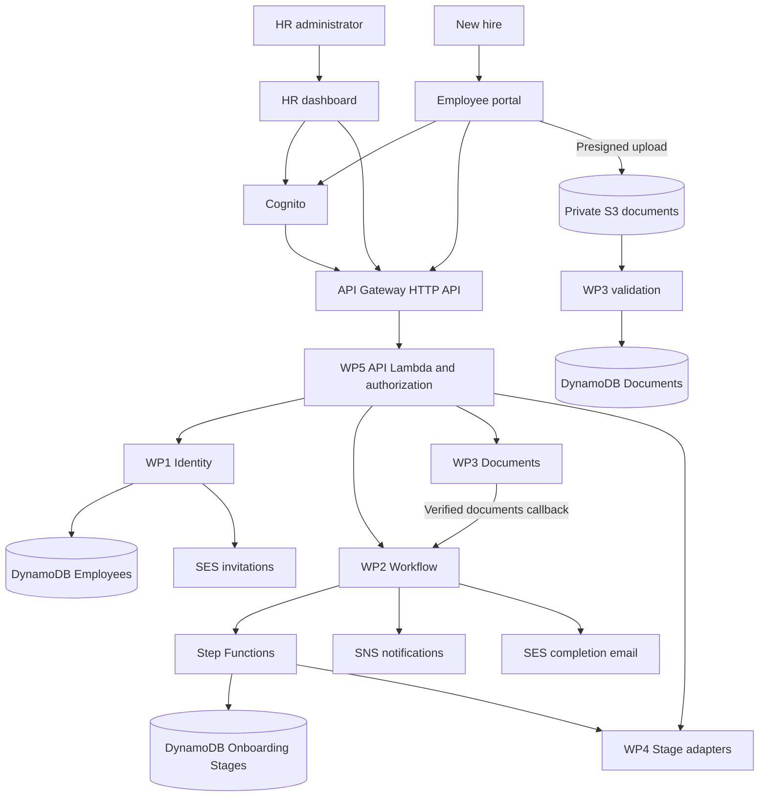
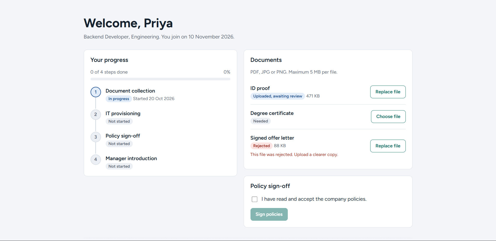
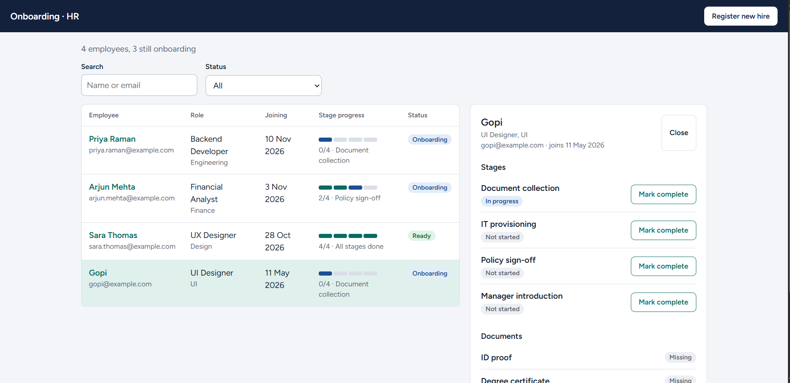

# Smart Employee Onboarding Platform

An AWS serverless employee-onboarding system that connects identity provisioning, document collection, workflow orchestration, HR operations and employee self-service in one integrated application.

[](https://github.com/amit-cloudops-ai/hrms-onboarding-service/actions/workflows/unit-tests.yml)
[](https://aws.amazon.com/)
[](https://www.python.org/)
[](https://react.dev/)
[](https://docs.aws.amazon.com/serverless-application-model/)

## Project overview

The platform coordinates a new hire's journey from employee registration to Day 1 onboarding. HR administrators manage employees and review onboarding progress through a dedicated dashboard; employees authenticate through Cognito and complete their required tasks in a self-service portal.

The backend is split into independently testable AWS Lambda services. Amazon API Gateway provides the authenticated HTTP boundary, DynamoDB stores canonical employee and stage state, Step Functions orchestrates the long-running process, and private S3 storage handles employee documents.

## Core capabilities

- **Identity and access:** employee records, Cognito identities, immutable Cognito-subject mapping, HR-admin authorization and employee self-service access.
- **Workflow orchestration:** four-stage Step Functions workflow, callback handling, reminders, correlation-bound stage transitions and completion notification reconciliation.
- **Document lifecycle:** short-lived presigned uploads, private S3 storage, server-side file validation, document status tracking, HR review and workflow callbacks.
- **HR operations:** employee registration, employee pipeline, progress visibility, document review and administrative actions.
- **Employee experience:** authenticated portal for onboarding progress, document submission and policy acknowledgement.
- **Operational controls:** offline tests, frontend lint/build, SAM template validation, CloudFormation lint, deployment-script checks and guarded deployment tooling.

## Architecture



See [the architecture source](docs/architecture.mmd), [the API contract](docs/api-contract.md) and [the data model](docs/data-model.md) for implementation details.

## Application preview

**Employee portal**



**HR operations dashboard**



## Technology stack

| Layer | Technologies |
|---|---|
| Identity and authentication | Amazon Cognito, API Gateway JWT authorizer |
| Backend services | Python 3.12, AWS Lambda, Boto3 |
| Workflow | AWS Step Functions, callback task tokens |
| Data and documents | Amazon DynamoDB, private Amazon S3 |
| Notifications | Amazon SNS, Amazon SES |
| Frontend | React, TypeScript, Vite |
| Infrastructure | AWS SAM, CloudFormation, IAM |
| Quality checks | Python unittest, ESLint, TypeScript build, cfn-lint, SAM validation, npm audit |
| CI | GitHub Actions |

## Repository structure

| Path | Responsibility | Work package |
|---|---|---|
| `services/identity/` | Employee identity and canonical profile | WP1 |
| `services/workflow/` | Step Functions orchestration, callbacks and notifications | WP2 |
| `services/documents/` | Upload URLs, validation, document state and HR review | WP3 |
| `services/stages/` | Policy acknowledgement and business-stage adapters | WP4 |
| `services/api/` | HTTP routes, authentication and authorization | WP5 |
| `frontend/portal/` | Employee self-service application | WP6 |
| `frontend/hr-dashboard/` | HR administration application | WP7 |
| `infra/` | AWS infrastructure and guarded deployment scripts | Shared |
| `docs/` | Architecture, contracts, runbooks, audit and team records | Shared |

## Run locally

### Prerequisites

- Python 3.12
- Node.js 20 or newer
- npm
- AWS SAM CLI for local template validation/builds

No AWS credentials are needed for the offline unit tests or frontend builds. Do not deploy infrastructure as part of local validation.

### Frontend applications

For the employee portal:

```bash
cd frontend/portal
npm ci
cp .env.example .env.local
npm run dev
```

For the HR dashboard, in a second terminal:

```bash
cd frontend/hr-dashboard
npm ci
cp .env.example .env.local
npm run dev
```

The environment examples use placeholder Cognito/API values. Use mock mode for local UI exploration, or configure the intended non-production Cognito and API endpoints before selecting live API mode. Never commit `.env.local` files or credentials.

### Backend tests

Install the local test dependency:

```bash
python -m pip install boto3 aws-sam-cli
```

Run the package test suites:

```bash
(cd services/identity && python -m unittest -v)
python -m unittest services.api.test_handler -v
(cd services/workflow && python -m unittest test_handler test_completion test_reconciliation test_callbacks -v)
(cd services/documents && python -m unittest -v)
python -m unittest services.stages.test_stages -v
```

Validate the backend infrastructure templates without deploying:

```bash
sam validate --lint --template-file services/api/template.yaml
sam validate --lint --template-file services/workflow/template.yaml
sam validate --lint --template-file services/documents/template.yaml
sam validate --lint --template-file services/stages/template.yaml
```

The GitHub Actions workflow runs the complete validation sequence, including frontend lint/build, dependency audit, CloudFormation lint, deployment-script syntax and SAM builds.

## Team contributions

This project was built collaboratively. Work-package ownership and contributor history are intentionally documented rather than attributing the entire system to one person.

| Contributor | Work packages | Contributions and evidence |
|---|---|---|
| [Amit Madakatti](https://github.com/amit-cloudops-ai) | WP1, WP2, WP5 and shared integration | Identity service, workflow orchestration, authenticated API, shared infrastructure, cross-service integration, CI and release coordination. |
| [Gopi](https://github.com/gk78-lab) | WP6, WP7 | Employee portal, HR dashboard, frontend mock layers, UI documentation and screenshots. See [merged PR #5](https://github.com/amit-cloudops-ai/hrms-onboarding-service/pull/5). |
| [Sushmitha](https://github.com/sush-kush) | WP3, WP4 | Initial document-service and stage-handler implementation, upload-event handling, validation, regression tests and integration documentation. See [WP3/WP4 contribution PR #6](https://github.com/amit-cloudops-ai/hrms-onboarding-service/pull/6) and the subsequent [workflow integration PR #7](https://github.com/amit-cloudops-ai/hrms-onboarding-service/pull/7), [S3 event fix #11](https://github.com/amit-cloudops-ai/hrms-onboarding-service/pull/11), [document/policy gate #12](https://github.com/amit-cloudops-ai/hrms-onboarding-service/pull/12) and [serialization fix #13](https://github.com/amit-cloudops-ai/hrms-onboarding-service/pull/13). |

The original team pull requests and author history are retained in GitHub. The detailed work-package ownership and integration boundaries are in [docs/team-work-packages.md](docs/team-work-packages.md).

## Engineering and deployment notes

- The checked-in infrastructure templates and scripts are designed for explicit review; CI validates them but does not deploy AWS resources.
- WP4 currently uses deterministic simulated adapters for IT provisioning and manager introduction. Real external provisioning and calendar providers are not configured.
- SES delivery depends on sender verification, recipient eligibility and the AWS account's SES state.
- Live AWS observations and the remaining runtime verification items are recorded in the [final project audit](docs/FINAL-PROJECT-AUDIT.md) and [implementation status](docs/implementation-status.md).
- Use synthetic identities and dummy documents for evaluation. Never commit employee PII, credentials, JWTs, Step Functions task tokens, presigned URLs or environment files.

## Documentation index

- [Team playbook](docs/team-playbook.md)
- [Work-package ownership](docs/team-work-packages.md)
- [API contract](docs/api-contract.md)
- [Data model](docs/data-model.md)
- [Architecture](docs/architecture.md)
- [Implementation status](docs/implementation-status.md)
- [Final project audit](docs/FINAL-PROJECT-AUDIT.md)
- [Cost estimate](docs/COST-ESTIMATE.md)
- [Mentor demo guide](docs/MENTOR-DEMO-GUIDE.md)
- [Contributing guide](CONTRIBUTING.md)

---

**Maintainer:** [Amit Madakatti](https://github.com/amit-cloudops-ai)  
**Repository:** [hrms-onboarding-service](https://github.com/amit-cloudops-ai/hrms-onboarding-service)
