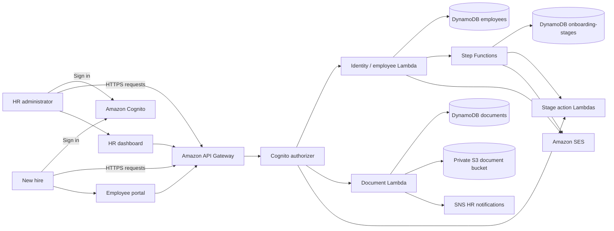

# System architecture

## Scope

This document describes the target architecture for the solo implementation on `v1-solo`. The first deployable milestone is the shared data, identity, notification, and private-document foundation. API handlers and workflow integrations will be added in subsequent vertical slices.

## Context and request flow

## Component responsibilities

| Component | Responsibility |
|---|---|
| Amazon Cognito | Authentication and HR-admin/employee groups; API authorization is enforced server-side. |
| API Gateway | HTTPS entry point, Cognito authorizer, request routing, throttling, and CORS allow-list. |
| Identity service | Validate employee input, create a canonical UUID-backed employee record, create the Cognito identity, and send an invitation with retry/compensation handling. |
| AWS Step Functions | Durable orchestration of document collection, IT provisioning, policy sign-off, and manager introduction. |
| DynamoDB | Employee, onboarding-stage, document-status, and equipment records. |
| Private S3 bucket | Encrypted employee document storage; clients upload only through short-lived, employee-scoped presigned URLs. |
| Amazon SNS | Notify HR when a document needs review or an important onboarding event occurs. |
| Amazon SES | Send invitation and reminder email after the sender identity is verified and delivery permissions are configured. |
| Employee portal / HR dashboard | Separate self-service and HR workflows; both use the same API contract. |

## Workflow and state

The four canonical stages are `document_collection`, `it_provisioning`, `policy_signoff`, and `manager_intro`. Stage state is stored as `pending`, `in_progress`, or `complete`. A scheduled reminder mechanism will identify stages that remain incomplete after 24 hours; it must be idempotent and avoid sending repeated reminders after completion.

Use Step Functions callback/task-token waits only when an external human action must resume a running execution. Treat task tokens as secrets: never return them to browsers or write them to ordinary logs. Persist them only if the chosen callback design requires it, with access restricted to the workflow role.

## Security boundaries

- All resources are deployed in `us-east-1` with environment-specific names.
- No real employee records or documents are used for development or demos.
- S3 public access is blocked; bucket policy denies non-TLS requests and default encryption is enabled.
- API authorization is not a substitute for ownership checks. Employee routes must verify that the authenticated subject owns the requested employee record; HR-only operations require the HR-admin group.
- Lambda roles are scoped to the tables, bucket prefixes, topics, and state machine they actually need.
- Validate file contents and size server-side; do not trust client-provided MIME types or filenames.
- Secrets and configuration belong in managed configuration/secret stores, never Git. Structured logs must exclude tokens, credentials, and document contents.
- Apply explicit log retention, throttling, input validation, dependency scanning, and least-privilege IAM.

## Reliability and operations

- Registration must be idempotent and handle partial failures between DynamoDB, Cognito, and email delivery.
- Workflow retries use bounded backoff and explicit failure states; manual redrive must not duplicate side effects.
- Document events and stage transitions must be safe under duplicate delivery.
- CI validates formatting, tests, dependency security, and the SAM/CloudFormation template before deployment.
- A development deployment is not production-ready until restore/rollback, alerting, privacy retention, and authorization tests are demonstrated.

## Deployment milestones

1. **Foundation:** SAM template for DynamoDB, private S3, Cognito groups, and SNS; validate before deployment.
2. **Identity vertical slice:** employee registration and retrieval with idempotency and tests.
3. **Workflow vertical slice:** four-stage Step Functions orchestration and 24-hour reminders.
4. **Documents vertical slice:** scoped upload URLs, validation, status tracking, and HR notifications.
5. **API and UI:** Cognito-protected routes, ownership checks, portal, and dashboard.
6. **Hardening:** observability, CI, security tests, operational runbooks, cost estimate, and teardown/redeploy verification.

## Deliberate initial exclusions

The foundation template does not yet create a public API, invoke SES, or start workflow executions. Those integrations will be added with their handlers and permission boundaries so each deployable increment can be tested independently.
