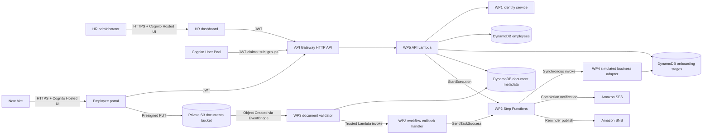

# System architecture

## Runtime topology

This diagram describes the intended and repository-implemented team-demo flow. The AWS audit verifies that the core resources exist; individual live request paths still require the release-gate tests in [the final audit](FINAL-PROJECT-AUDIT.md).

## Ownership boundaries

| Component | Responsibility | Boundary |
|---|---|---|
| WP1 — Identity | Validate employee input, create Cognito identity, persist immutable Cognito `sub` on the employee record | Does not own HTTP routing or workflow sequencing |
| WP2 — Workflow | Own Step Functions orchestration, task tokens, canonical stage status, correlation IDs, reminders and completion notification | Task tokens stay inside trusted backend services; never return them to a browser |
| WP3 — Documents | Issue presigned S3 upload URLs, store metadata, validate uploaded objects, signal document readiness to WP2 | Private S3 bucket; browser receives neither bucket key nor task token |
| WP4 — Stages | Record versioned policy acceptance and execute IT/manager demonstration adapters | `MODE=simulated`; no real provider integrations are configured |
| WP5 — API | Enforce JWT, HR-group and employee-self authorization; call the service adapters | Self-service authorization uses Cognito `sub`, not mutable email |
| WP6/WP7 — Frontends | Employee portal and HR dashboard | Mock adapters must be disabled in deployed builds |

## Lifecycle and notification semantics

The employee lifecycle and email delivery are separate state dimensions:

- The employee becomes `complete` only after all four required stage records are durably `complete`.
- Completion email state is independently `sending`, `sent`, or `failed`.
- A definitive SES rejection is a notification failure, not an onboarding failure.
- An ambiguous transport outcome remains `sending` for operator reconciliation; do not blindly retry and risk duplicate email.
- The Step Functions `WorkflowComplete` state is the single owner of the completion notification attempt.

## Deployment topology

The audited account contains two CloudFront distributions, a separate Lambda Function URL hosting stack, and an older hosting stack in `ROLLBACK_COMPLETE`. The checked-in deployment script still targets the old stack. Resolve this drift and designate one canonical host before another deployment.

## Mentor-demo boundary

WP4 returns deterministic simulated outcomes for IT provisioning and manager introduction. This is appropriate for an evaluation demonstration when disclosed clearly. It is not a live provisioning integration and must not be presented as one.
